# 淘宝用户行为与商品运营综合分析报告

> 项目观察窗口为2017年11月25日至12月3日（北京时间），覆盖约1亿条匿名行为日志。本文将经营结论、运营场景、指标口径、详细结果和验证方案合并为一份报告。

## 阅读说明

报告先呈现经营结论和行动建议，再按平台经营、转化、时段、用户、商品五个模块展开，并在后半部分保留详细指标结果、方法边界和数据质量说明。分析来自观察性日志，文中的运营方案是待验证假设。

# 淘宝用户转化与商品运营分析

## 淘宝用户转化与商品运营分析

从一亿条行为日志，寻找用户转化与商品效率的增长机会

| 分析行为记录 | 活跃用户 | 购买用户 |
| --- | --- | --- |
| 100,095,231 | 987,991 | 672,404 |

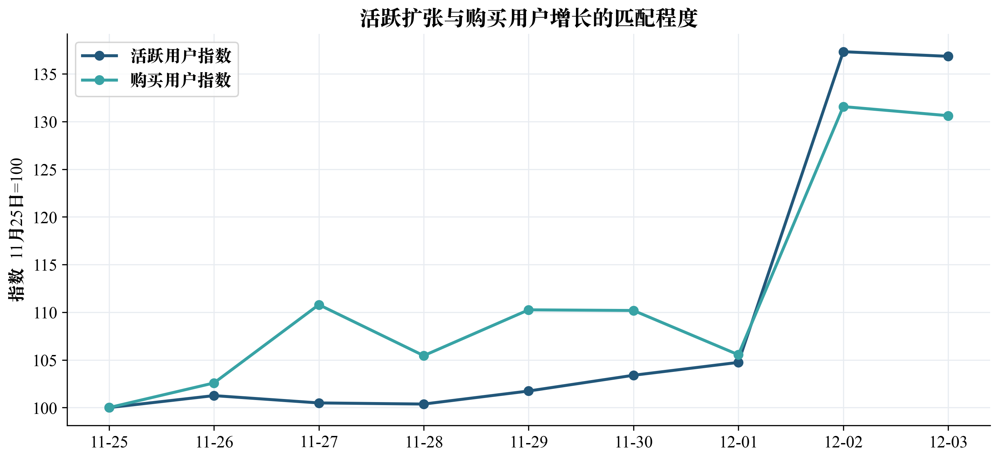

增长质量：活跃用户增长37.32%，购买用户增长31.57%，购买承接速度落后于流量扩张。

用户运营：识别117,340名高活跃未购加购用户，形成意向转化重点人群。

商品运营：筛出100个高流量低转化优先商品，将流量效率问题落到具体SKU。

Python分块处理 + SQL聚合 + 用户行为分析 + Power BI六页报表

## 将运营重心放在三个增长机会

| 优先级 | 业务机会 | 关键证据 | 运营方向 |
| --- | --- | --- | --- |
| P1 | 意向用户购买转化 | 11.73万人高活跃、已加购、未购买 | 分品类回访；打通加购后的购买承接 |
| P1 | 高流量商品提效 | 14,920个SKU承接33.65%观察量，仅贡献8.10%转化 | 从100个重点SKU开始，排查可售、页面和流量匹配 |
| P2 | 购买频次经营 | 25.79%的买家贡献50.63%购买行为 | 建立高频服务与单日买家再次购买机制 |

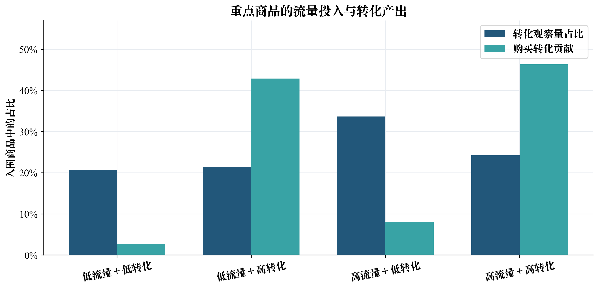

衡量运营质量，不只看新增浏览与活跃：同时追踪目标人群购买率、同商品24小时转化和购买频次。

报告形成了可执行的人群与商品优先级。资源安排按“覆盖规模 × 转化表现 × 操作可行性”展开。

## 把一亿条日志转化为可复用的经营数据

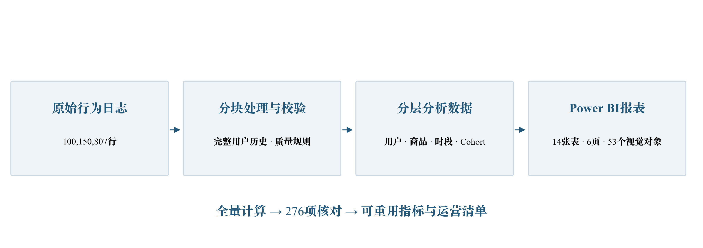

| 工程问题 | 处理方法 | 形成的能力 |
| --- | --- | --- |
| 大文件内存压力 | 分块读取；跨块保留完整用户历史；SQL落地聚合 | 全量计算1亿条行为，覆盖98.80万用户 |
| 时间与事件顺序 | 统一北京时间，按用户、商品匹配行为及后续购买 | 构建1h、24h、48h转化与完整随访分母 |
| 多粒度分析 | 组织用户日、商品日、用户商品对与Cohort数据 | 支撑经营、转化、时段、用户和商品分析 |
| 结果一致性 | 13项跨表核对、263项独立检查、原始路径抽核 | 15,183,398行商品日表完成总量对账 |

质量治理：原始100,150,807条记录，按分析窗口保留100,095,231条；剔除窗口外55,576条，字段解析有效。对重复日志、多品类映射与同秒行为建立审计记录。

交付层：14张报表数据表、DAX业务度量与6页Power BI分析界面。处理代码、汇总数据和运营清单配套保留。

## 活跃增长快于购买，承接效率成为重点

| 指标 | 11月25日 | 12月2日 | 变化 |
| --- | --- | --- | --- |
| 活跃用户 | 706,641 | 970,401 | +37.32% |
| 购买用户 | 132,622 | 174,487 | +31.57% |
| 当日购买用户占比 | 18.77% | 17.98% | -0.79个百分点 |

流量扩张已带来购买人数增长，但购买用户占比同步下降。经营重点应从单看DAU，转向新增活跃是否进入商品意向与购买链路。

运营动作：在高流量日期拆分用户层与商品层，先检查新增活跃集中在哪类人群、浏览哪些商品，再把重点资源导向意向用户和高流量低转化商品。

经营复盘以“活跃规模—购买人数—购买覆盖”三项联动，识别增长来自规模还是效率。

## 加购覆盖74.80%，意向承接是关键触点

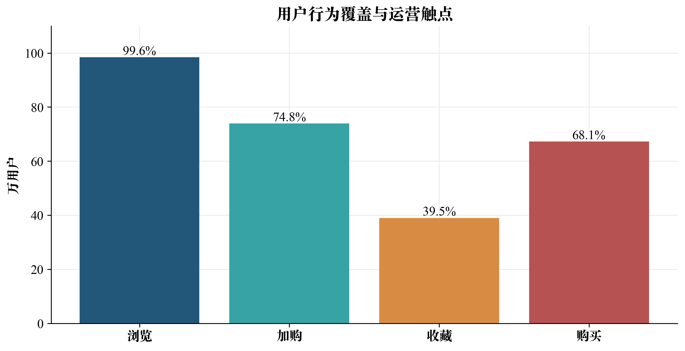

| 经营指标 | 结果 | 运营用途 |
| --- | --- | --- |
| 浏览次数 | 89,660,688 | 衡量流量规模 |
| 浏览用户 | 984,105 | 衡量商品触达 |
| 加购用户 | 738,996 | 形成商品意向触点 |
| 收藏用户 | 389,823 | 形成持续关注触点 |
| 购买用户 | 672,404 | 衡量期间购买覆盖 |
| 每位浏览用户浏览次数 | 91.11 | 衡量浏览深度 |

用户在九天内浏览频繁，加购触点覆盖广。运营应把浏览、收藏、加购与购买状态组合起来，区分“有兴趣但未下单”与“已买过、还在继续逛”。

整体购买用户占比68.06%。行为覆盖用于识别人群，商品转化用于定位购买链路，两层指标共同支持运营。

## 加购后的购买率是浏览起点的3.33倍

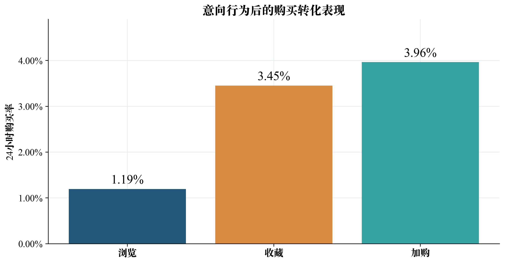

| 行为起点 | 完整24h观察对数 | 购买转化对数 | 购买率 |
| --- | --- | --- | --- |
| 浏览 | 61,713,539 | 735,437 | 1.19% |
| 收藏 | 2,481,639 | 85,661 | 3.45% |
| 加购 | 4,639,111 | 183,827 | 3.96% |

加购后24小时购买率3.96%，高于收藏3.45%和浏览1.19%。对有限运营资源，先经营已表达商品意向的用户，比只按活跃程度安排同一套触达更有针对性。

加购24小时未购仍有4,455,284个用户—商品关系。将该关系落到用户与具体商品，形成回访清单，并对用户去重、设置频控。

转化统计单位为用户—商品对，观察行为起点后同商品购买。此处的倍率描述行为关联，用于确定运营优先级。

## 用意向类型与购买节奏设计两条运营路径

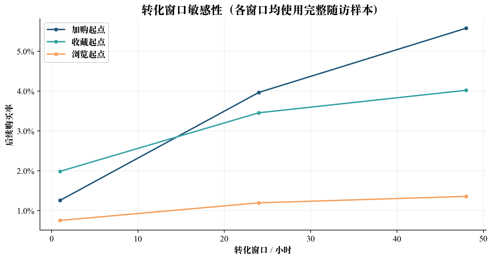

| 起点 | 1小时购买率 | 24小时购买率 | 48小时购买率 |
| --- | --- | --- | --- |
| 浏览 | 0.75% | 1.19% | 1.35% |
| 收藏 | 1.98% | 3.45% | 4.02% |
| 加购 | 1.25% | 3.96% | 5.57% |

收藏在1小时窗口内购买率1.98%，加购为1.25%；在24与48小时窗口，加购表现更高。可据此设计“短时兴趣回访”和“跨日购物车承接”两套节奏，分别测试内容与时机。

| 已观察的浏览分支 | 进入意向行为 | 随后购买 | 意向至购买 |
| --- | --- | --- | --- |
| 浏览 → 加购 → 购买 | 507,413 | 33,914 | 6.68% |
| 浏览 → 收藏 → 购买 | 215,545 | 16,827 | 7.81% |

两条分支分别统计浏览起点后24小时的顺序行为。运营同时保留直接购买入口，并围绕收藏与加购设计不同的回访内容。

## 活跃度不能单独决定加购用户的运营顺序

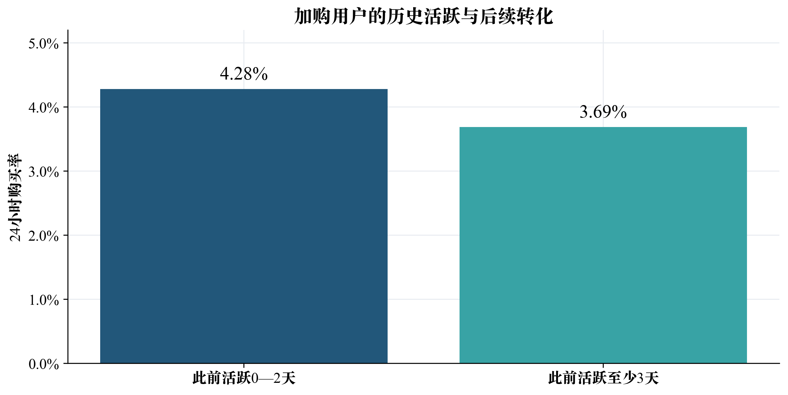

加购前已活跃至少3天的人群，后续24小时购买率3.69%；此前活跃0—2天的人群为4.28%。更频繁到访并不自动对应更强的即时购买倾向。

| 诊断层 | 需要回答的问题 | 对应动作 |
| --- | --- | --- |
| 用户 | 近期是否已买过；意向集中还是分散 | 购买频次与商品意向联合分层 |
| 商品 | 是否可售；价格、详情与需求是否匹配 | 优先核查高流量低转化SKU |
| 时机 | 用户还在比较，还是已放弃当前商品 | 按加购时长测试提醒与替代商品推荐 |
| 反馈 | 触达后是购买、继续浏览还是退订 | 用购买率、延迟与退订共同评价 |

执行重点：先按品类、意向行为和购买历史分层，再决定触达时机。相同用户合并多个商品意向，避免重复消息消耗用户体验。

## 21点承接流量，10点测试意向回访

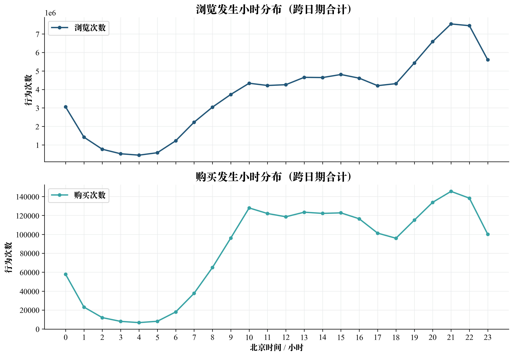

浏览与购买行为在21点达到峰值，晚间是页面、商品与服务承接的重点。起点转化分析则显示，10点浏览后的24小时购买率最高。

| 运营场景 | 重点安排 | 跟踪指标 |
| --- | --- | --- |
| 晚间流量承接 | 20—22点确保重点商品可售、页面顺畅与咨询响应 | 浏览量、购买人数、商品转化率 |
| 上午意向回访 | 将10点纳入加购/收藏用户的回访时段测试 | 目标用户购买率、购买延迟 |
| 跨时段协同 | 晚间沉淀意向，次日分层回访 | 跨日购买与频控表现 |

把“购买发生时段”用于承接排班，把“浏览起点后的购买表现”用于回访测试，形成按场景配置资源的运营节奏。

## 周末流量多17.73%，买家只多7.14%

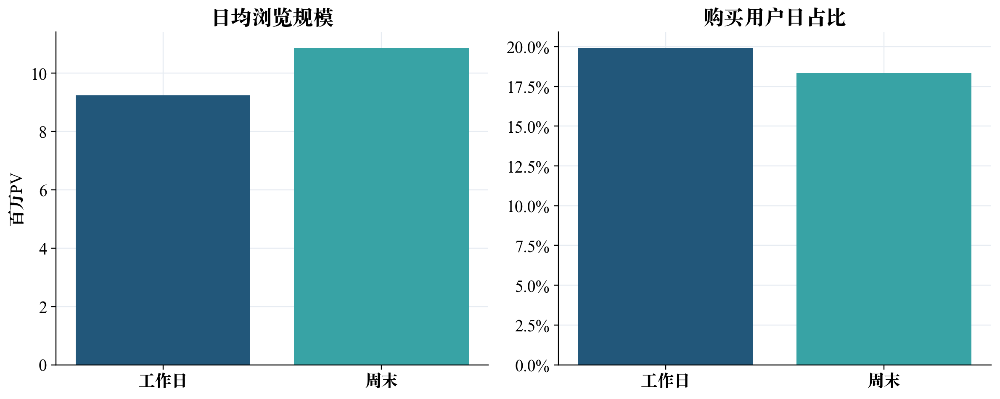

| 指标 | 工作日 | 周末 |
| --- | --- | --- |
| 日均PV | 9,234,580 | 10,871,948 |
| 购买用户日占比 | 19.93% | 18.35% |

周末日均浏览比工作日高17.73%，日均购买人数仅高7.14%，购买用户日占比低1.58个百分点。周末经营需要同时提升流量承接与意向沉淀。

周末：强化高流量商品承接，围绕热门品类组织页面和推荐内容，让浏览转化为可持续跟进的商品意向。

工作日：针对周末已加购、已收藏但未购买的人群测试回访，将“周末逛、工作日再购买”纳入运营节奏。

验收同时看周末购买覆盖和后续完整观察期的购买，避免只以当日PV评价资源配置。

## 64.53%的高活跃用户贡献82.42%浏览

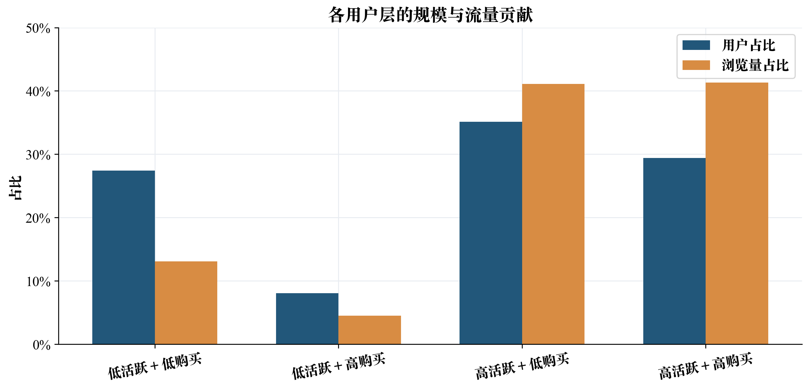

| 用户层 | 用户规模 | 流量贡献 | 经营重点 |
| --- | --- | --- | --- |
| 低活跃＋低购买 | 270,845 | 13.07% | 低频轻触达，降低打扰 |
| 低活跃＋高购买 | 79,632 | 4.51% | 强化目的性需求与回访 |
| 高活跃＋低购买 | 346,872 | 41.11% | 解决意向到购买的承接 |
| 高活跃＋高购买 | 290,642 | 41.32% | 高频服务与关联推荐 |

高活跃低购买群体有346,872人，独立贡献41.11%的浏览量，是流量最集中的转化运营对象。将该群进一步拆分，能比面向全体活跃用户统一运营更具体。

分层规则：活跃至少7天为高活跃；购买至少2个自然日为高购买。四个人群互斥，覆盖全部98.80万活跃用户。

## 11.73万名未购加购用户是首要转化对象

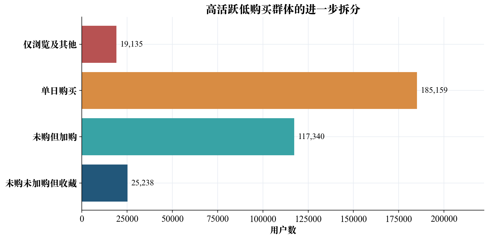

高活跃低购买群体中，未购用户161,713人，其中117,340人已有加购行为，占72.56%。该群已多次到访且有明确商品意向，适合作为购买转化的优先运营对象。

| 运营人群 | 人数 | 内容与动作 | 主指标 |
| --- | --- | --- | --- |
| 未购但加购 | 117,340 | 购物车商品回访；可售确认；相关替代商品 | 后续购买用户率 |
| 未购未加购但收藏 | 25,238 | 收藏商品内容与比较信息 | 收藏商品购买率 |
| 单日购买 | 185,159 | 关联商品推荐；跨日再次购买 | 3日再次购买率 |
| 仅浏览及其他 | 19,135 | 浏览兴趣内容与低频唤回 | 有效回访与意向行为 |

已导出用户ID、行为次数与分层标签明细。上线时关联意向商品与品类，更新近期购买状态，执行可售、触达资格与频控规则。

## 25.79%的买家贡献一半购买行为

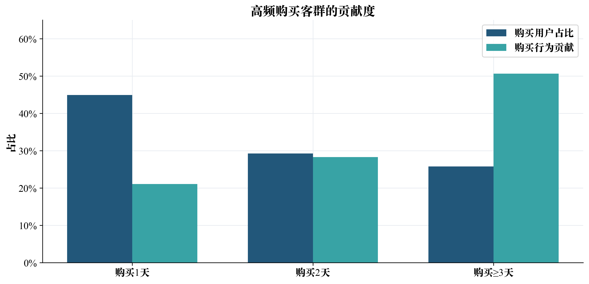

| 购买客群 | 人数 | 占买家比例 | 购买行为贡献 |
| --- | --- | --- | --- |
| 购买1天 | 302,130 | 44.93% | 21.09% |
| 购买2天 | 196,830 | 29.27% | 28.28% |
| 购买至少3天 | 173,444 | 25.79% | 50.63% |

购买至少3天的高频用户仅占买家约四分之一，却贡献50.63%的购买行为。购买频次经营应兼顾核心买家服务和单日买家向再次购买的迁移。

高频买家：保持商品可得性与服务体验，以关联商品和跨品类推荐拓展需求。单日买家：围绕首次观察购买后的三日窗口安排内容回访，观察第二个购买日是否形成。

跨日购买用户370,274人，占买家55.07%。购买行为量与购买自然日共同衡量频次价值。

## 把回访与再次购买连接成持续运营节奏

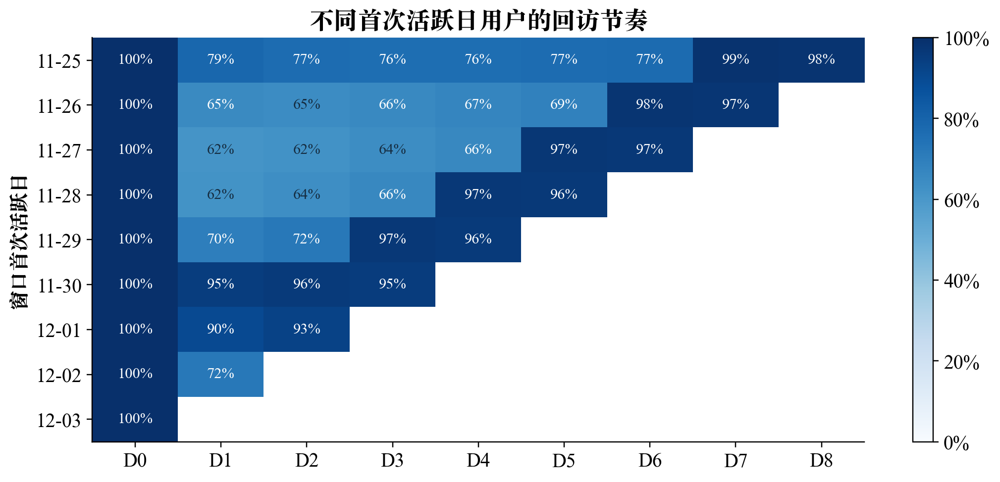

以窗口首次活跃日建立Cohort，追踪用户后续精确日回访。最早两天同批864,829名用户，D1回访76.40%，D3为74.08%，D7为98.33%；D7对应12月2日和3日的集中活跃。

| 观察结果 | 运营安排 | 复盘指标 |
| --- | --- | --- |
| 12月2/3日集中回访 | 提前组织重点商品与意向用户承接 | 回访用户的意向与购买覆盖 |
| 首次观察购买后3日再次购买率42.27%—48.77% | 围绕购买后1—3日测试关联内容回访 | 统一3日观察的再次购买率 |
| 可观察跨日购买间隔中位45.91小时 | 将约两日作为短期回访测试节点 | 购买延迟、触达频次、退订 |

用户运营从“是否回来”推进到“回来后是否产生意向与购买”，将回访、商品承接和购买频次纳入同一条复盘链路。

## 用人群品类偏好组织商品与回访内容

| 高活跃低购买群偏好品类 | 群内浏览占比 | 偏好指数 |
| --- | --- | --- |
| 4756105 | 5.40% | 1.08 |
| 2355072 | 4.01% | 1.14 |
| 3607361 | 3.88% | 1.17 |
| 4145813 | 3.72% | 1.06 |
| 982926 | 3.37% | 1.08 |

品类2355072与3607361在该人群中的浏览占比分别约为整体的1.14倍和1.17倍。品类偏好可用于组织商品池、页面内容和回访信息，使运营围绕用户已经关注的需求展开。

| 使用场景 | 筛选规则 | 落地内容 |
| --- | --- | --- |
| 意向回访 | 用户已加购/收藏的品类优先 | 突出原意向商品与同需求替代商品 |
| 商品治理 | 偏好品类 × 高流量低转化SKU | 集中核查高关注但购买较弱的商品 |
| 关联推荐 | 已购品类 × 高频用户浏览偏好 | 围绕相近需求建立关联商品候选 |
| 效果复盘 | 同一品类内比较人群与商品 | 定位是人群差异还是商品承接差异 |

偏好指数 = 群内品类浏览占比 ÷ 整体品类浏览占比。数据使用匿名品类ID，运营对接时通过商品目录映射实际品类与负责人。

## 三分之一的商品观察量，只贡献8.10%转化

| 入围商品象限 | SKU数 | 观察量占比 | 转化贡献 |
| --- | --- | --- | --- |
| 低流量＋低转化 | 40,202 | 20.72% | 2.68% |
| 低流量＋高转化 | 42,628 | 21.37% | 42.89% |
| 高流量＋低转化 | 14,920 | 33.65% | 8.10% |
| 高流量＋高转化 | 12,795 | 24.26% | 46.33% |

在110,545个达到样本门槛的商品中，14,920个高流量低转化商品承接33.65%的完整浏览起点，却只贡献8.10%的购买转化。这里是商品提效的重点，而不是继续平均增加流量。

同一入围范围内，高流量低转化群整体购买率0.26%，高流量高转化群为2.09%。先优化承接不足的重点SKU，再结合品类和需求匹配安排流量。

象限标准：浏览UV以344为分界；24小时转化率以入围商品中位数0.6757%为分界。

## 把商品效率问题落到100个优先SKU

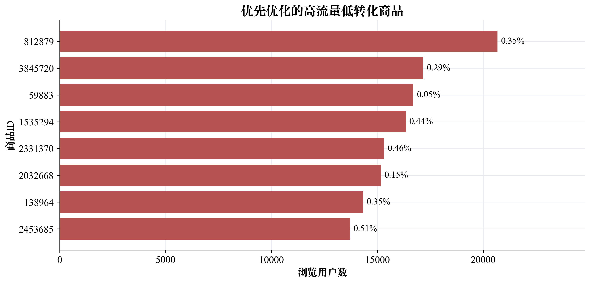

| 优先商品ID | 浏览UV | 完整浏览起点 | 24h转化率 |
| --- | --- | --- | --- |
| 812879 | 20,667 | 18,369 | 0.35% |
| 3845720 | 17,163 | 15,034 | 0.29% |
| 59883 | 16,701 | 13,987 | 0.05% |
| 1535294 | 16,340 | 12,622 | 0.44% |
| 2331370 | 15,319 | 13,351 | 0.46% |

前10个候选累计132,208个完整浏览起点，仅409个转化，整体购买率0.31%。相比泛化地要求“提升转化”，按SKU建立问题清单更便于确定责任人和复盘。

商品812879：20,667名浏览用户、18,369个完整起点、64个购买转化，购买率0.35%。优先核查可售与库存，其次检查详情信息和需求匹配，再分渠道比较流量质量。

按“问题证据—负责人—改动—复盘结果”管理清单。对商品59883等更低转化候选，保留同品类对照，区分商品问题与流量人群问题。

## 商品资源分配采用样本与效率双门槛

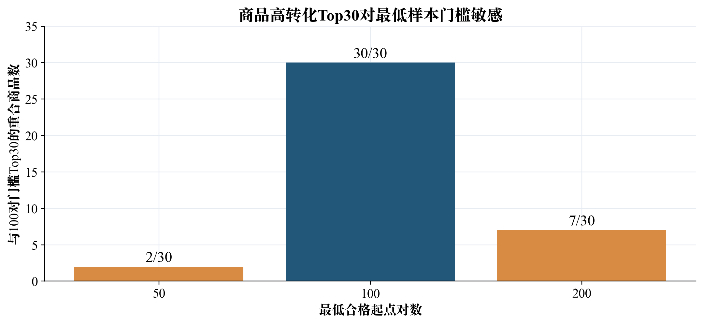

| 最低完整起点数 | 满足条件商品 | 与100起点榜Top30重合 |
| --- | --- | --- |
| 50 | 226,765 | 2/30 |
| 100 | 110,545 | 30/30 |
| 200 | 48,187 | 7/30 |

样本门槛从50提高到100、200时，转化Top30明显变化，三个榜单没有共同商品。运营选品应把流量样本与转化效率一起纳入，避免只追逐极端高转化百分比。

| 商品类型 | 资源策略 | 执行顺序 |
| --- | --- | --- |
| 高流量低转化 | 优化承接后再追加流量 | 先处理100个重点SKU |
| 低流量高转化 | 控制规模做扩流测试 | 按同品类和样本稳定性筛选 |
| 高流量高转化 | 稳定供给与服务，保留核心曝光 | 监控可售与效率波动 |
| 低流量低转化 | 降低优先级，匹配具体需求 | 保留基础观察与定期复盘 |

## 六页Power BI报表串联监控与行动

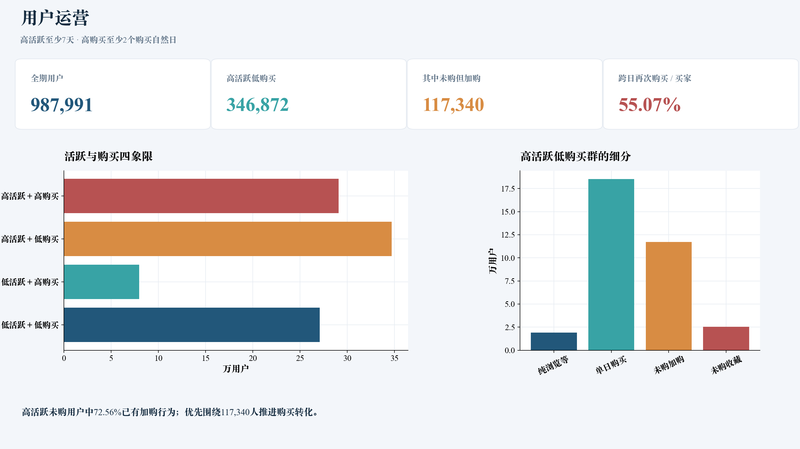

| 分析页面 | 回答的业务问题 | 支持的决策 |
| --- | --- | --- |
| 经营总览 | 流量增长是否带来购买增长 | 追踪购买覆盖与增长质量 |
| 转化诊断 | 哪些意向行为值得优先经营 | 制定分层回访与时间窗 |
| 时段运营 | 何时承接流量、何时测试回访 | 安排时段资源与服务 |
| 用户运营 | 先运营谁、采用什么内容 | 四象限与意向细分 |
| 留存复购 | 用户何时回来、何时再次购买 | 连接回访与购买频次 |
| 商品机会 | 先优化哪些商品 | 象限筛选与SKU清单 |

Power Query组织14张报表表，DAX统一比例与规模指标；配置日期、意向与商品象限筛选。商品页联动散点和明细，将经营问题推进到具体候选。

## 按人群、商品与时段推进运营闭环

| 工作项 | 执行动作 | 协作角色 | 核心指标 |
| --- | --- | --- | --- |
| 意向购买转化 | 11.73万人分品类回访；购物车提醒与替代推荐分组测试 | 用户运营、商品运营 | 分组后24h购买用户率 |
| 高流量商品治理 | 100个SKU形成可售、详情、价格及流量核查清单 | 商品运营、商家、产品 | 同商品24h转化率 |
| 购买频次经营 | 高频买家服务；单日买家购买后1—3日回访 | 用户运营、推荐 | 3日再次购买率 |
| 时段资源 | 21点保障承接；10点测试意向回访 | 运营、客服、产品 | 购买覆盖与购买延迟 |

第一阶段：更新人群与商品清单，核查可售、近期购买和触达资格，明确负责人。第二阶段：分人群、品类开展小范围测试，保持用户固定分组。第三阶段：复盘购买率与服务反馈，将有效策略扩展到相似对象。

实验评价以目标购买指标为主，同时跟踪退订、投诉与触达频次。购买提升由分组结果确认，报告中的覆盖人数和转化差异用于安排策略优先级。

指标口径

数据来自天池UserBehavior匿名日志，分析窗口为2017年11月25日至12月3日（北京时间）。PV为浏览次数，UV为任意行为去重用户；购买量为购买行为记录。转化按同用户同商品的首次窗口内行为起点，要求购买严格晚于起点并具有完整随访。1h、24h、48h各自使用相应完整观察样本。Cohort按窗口首次活跃日，复购按购买自然日统计。

分析输出：全量处理链路、经营指标体系、117,340人重点转化人群、100个商品优化候选、六页Power BI项目与可执行运营方案。

---

# 详细分析结果与方法依据

以下内容提供完整指标、分析口径和限制，用于复核前文业务发现。

## 分析口径、详细结果与解释边界

分析范围：2017-11-25—2017-12-03（北京时间）。全量计算，无用户抽样。匿名样本不代表全平台经营；以下为观察性结果。

## 核心发现

1. 清洗保留 100,095,231 条行为、987,991 位用户；期间购买用户占比 68.06%。该比例衡量窗口内是否购买，不是浏览后顺序转化率。
2. 同用户同商品完整24小时随访下，浏览→购买为 1.19%，加购→购买为 3.96%，收藏→购买为 3.45%。加购和收藏对应的人群、品类与行为时点不同，原始差异不构成营销因果效应。
3. 跨日期合计浏览次数在 21:00—21:59 最高，购买行为次数在 21:00—21:59 最高；浏览起点24小时转化率最高时段为 10:00—10:59。购买发生时点与浏览起点不可混用。
4. 窗口首次活跃 Cohort 的可观察加权 D1/D3/D7 留存分别为 75.04%、73.83%、98.33%；各期限使用不同的可完整随访 Cohort，不能直接解释为同一人群的衰减曲线。
5. 可观察相邻购买日间隔均值 57.24 小时、中位数 45.91 小时，来自 370,274 位用户的 663,076 个间隔。短窗口更容易观察到短间隔，不能据此推断长期复购周期。

## 一、平台整体经营分析

| PV | UV | 浏览UV | 收藏人数 | 加购人数 | 购买人数 | 人均浏览量 | 期间用户购买率 |
| --- | --- | --- | --- | --- | --- | --- | --- |
| 89660688 | 987991 | 984105 | 389823 | 738996 | 672404 | 91.1089 | 0.6806 |

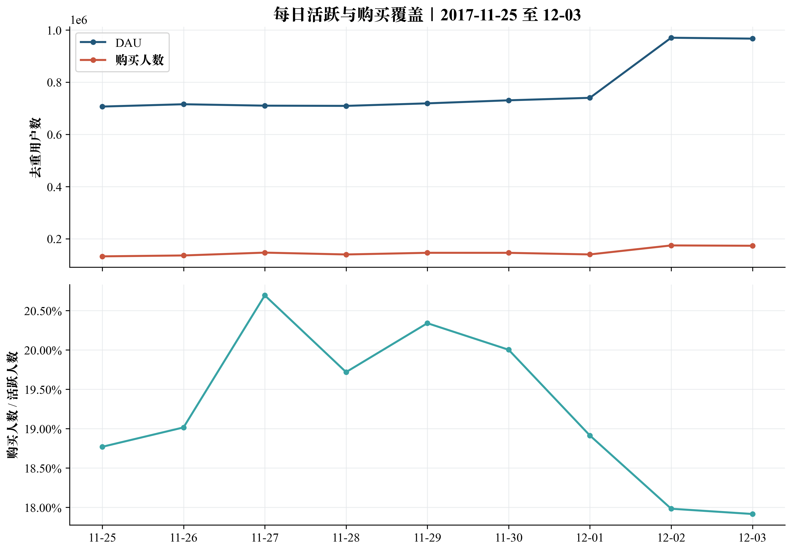

观察期内DAU最高日为 2017-12-02，活跃用户 970,401。首日与末日DAU分别为 706,641 和 966,977；窗口两端变化不能归因于某项运营措施。

每日指标见 `02_overview/daily.csv`。UV定义为至少发生一次任意行为的用户；人均浏览以浏览UV为分母。购买日志不等于订单，不能计算GMV、客单价或利润。

## 二、转化漏斗与意向行为

| behavior | eligible_pairs | converted_pairs | unconverted_pairs | conversion_rate | censored_pairs |
| --- | --- | --- | --- | --- | --- |
| cart | 4639111 | 183827 | 4455284 | 0.0396 | 747473 |
| fav | 2481639 | 85661 | 2395978 | 0.0345 | 388338 |
| pv | 61713539 | 735437 | 60978102 | 0.0119 | 9301653 |

单位为用户—商品对；`censored_pairs` 为起点之后不足完整24小时而排除的对数。首次合格行为指该对在清洗窗口内的首次该类行为，不代表历史首次。后续购买要求严格晚于起点且不超过24小时。

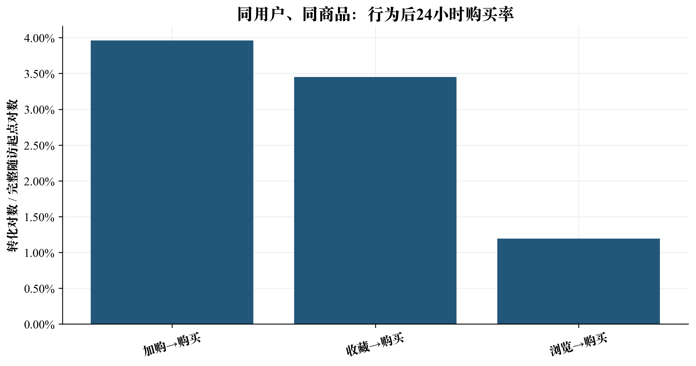

| path | start_pairs | middle_pairs | purchase_pairs | start_to_buy_rate | middle_to_buy_rate |
| --- | --- | --- | --- | --- | --- |
| pv_cart_buy | 61713539 | 507413 | 33914 | 0.0005 | 0.0668 |
| pv_direct_buy | 61713539 | 0 | 686380 | 0.0111 | — |
| pv_fav_buy | 61713539 | 215545 | 16827 | 0.0003 | 0.0781 |

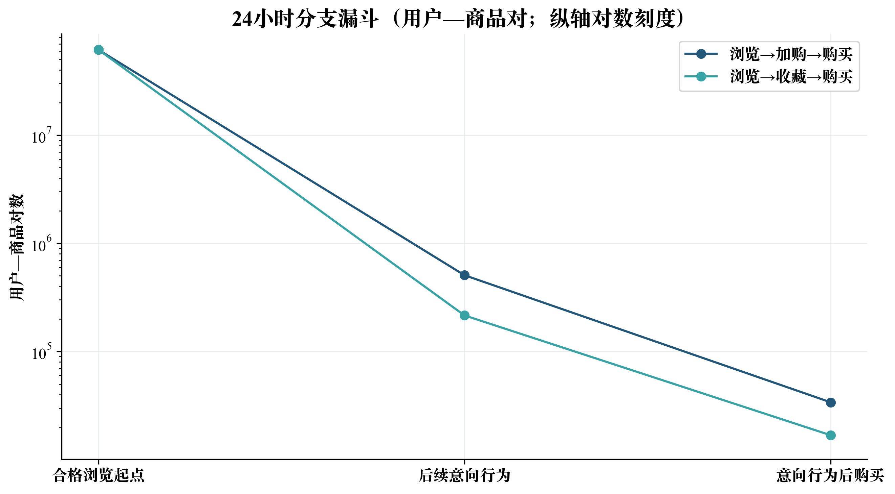

按三个独立起点比较，未在24小时内购买的规模最大的是 浏览 起点，未转化 60,978,102 对；未转化比例最高的是 浏览 起点，为 98.81%。它们的起点人群不同，不直接等价于一条单向漏斗上的流失排序。

“浏览→收藏→购买”和“浏览→加购→购买”可能重叠，不能相加。`pv_direct_buy`仅表示最早合格购买前未观察到严格更早的收藏/加购；同秒事件顺序未知，不能据此证明真实直接路径。起点到中间行为的下降表示该路径覆盖减少，不自动等于购买流失；应同时看每类起点的未购买规模与条件转化率。

### 加购后未购的排查

加购起点24小时内未购买的用户—商品对为 4,455,284。对照 `historical_segments.csv` 和 `category_conversion.csv`，先识别此前活跃程度与品类差异，再提出触达或商品排查假设。当前无价格、库存、评价、页面体验和流量渠道信息，不能证明具体原因。

历史分群仅使用起点日前已观察到的自然日，排除起点当天全部行为；因此比精确时点历史更保守。`prior_active_0to2` 可能包含窗口左侧历史未知的用户，不解释为新用户。

| behavior | history_group | eligible_pairs | converted_pairs | conversion_rate |
| --- | --- | --- | --- | --- |
| cart | prior_active_0to2 | 2176095 | 93062 | 0.0428 |
| cart | prior_active_3plus | 2463016 | 90765 | 0.0369 |
| fav | prior_active_0to2 | 1157761 | 41134 | 0.0355 |
| fav | prior_active_3plus | 1323878 | 44527 | 0.0336 |
| pv | prior_active_0to2 | 29694345 | 381567 | 0.0128 |
| pv | prior_active_3plus | 32019194 | 353870 | 0.0111 |

收藏/加购用户交叉覆盖见 `fav_cart_coverage.csv`，该表使用全窗口标签，只用于描述。1小时、24小时、48小时敏感性见 `window_sensitivity.csv`；不同窗口会排除不同数量末端样本。

## 三、时间分析

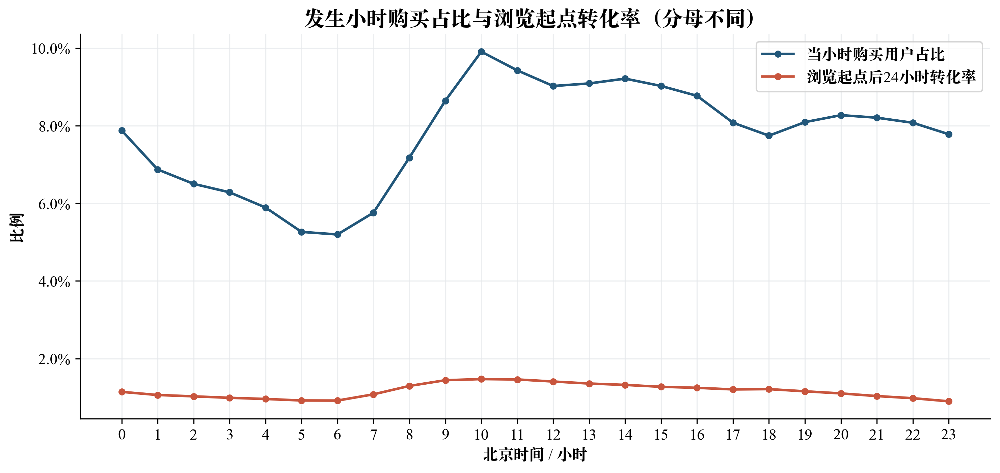

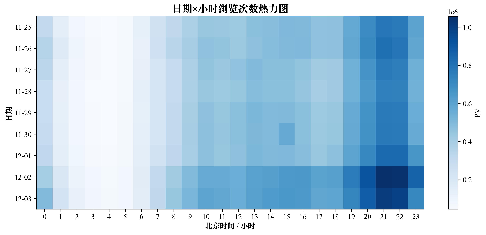

| day_type | days | pv | uv_user_days | buy_uv_user_days | daily_pv | daily_uv | purchase_rate |
| --- | --- | --- | --- | --- | --- | --- | --- |
| weekday | 5 | 46172898 | 3609009 | 719098 | 9234579.6000 | 721801.8000 | 0.1993 |
| weekend | 4 | 43487790 | 3359535 | 616382 | 10871948.0000 | 839883.7500 | 0.1835 |

工作日与周末规模用日均值比较；用户购买占比按用户—日加权，而非将多天去重人数冒充一个总体UV。只有九天，差异可能混合日期趋势，不能证明稳定周末效应。优先围绕已观察到的高活跃时段安排运营承接，并用完整转化随访验证，不能只追求当小时购买数。

## 四、用户分析

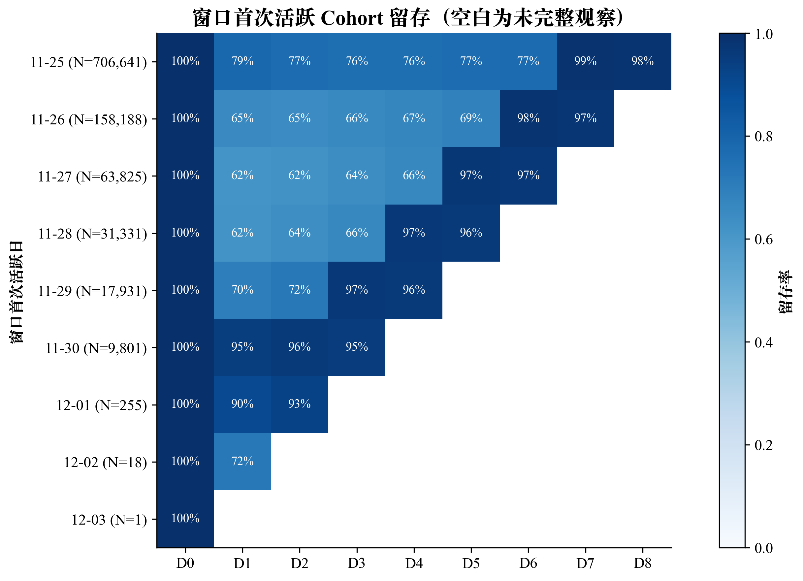

窗口内至少两个不同自然日购买的用户为 370,274 人，占购买用户的 55.07%；未购用户不进入该比例分母。

起始日记为D0；D1/D3/D7是精确第N天回访。空白单元格为观察不足。首次活跃日属于窗口内定义，不是注册日。

D7的可观察Cohort只有11月25日和26日，其回访目标日落在12月2日和3日，这两天的总体活跃人数也明显较高。不能把98%左右的D7解释成普遍留存水平或“留存随天数变好”；该现象需要结合样本生成方式和更多周数据进一步验证。后期Cohort人数很小，图中已标明N。为减少Cohort构成差异，下表固定使用最早两天的同一批用户比较三个期限，日期效应仍然存在：

| offset | cohort_users | retained_users | retention_rate |
| --- | --- | --- | --- |
| 1 | 864829 | 660759.0000 | 0.7640 |
| 3 | 864829 | 640653.0000 | 0.7408 |
| 7 | 864829 | 850409.0000 | 0.9833 |

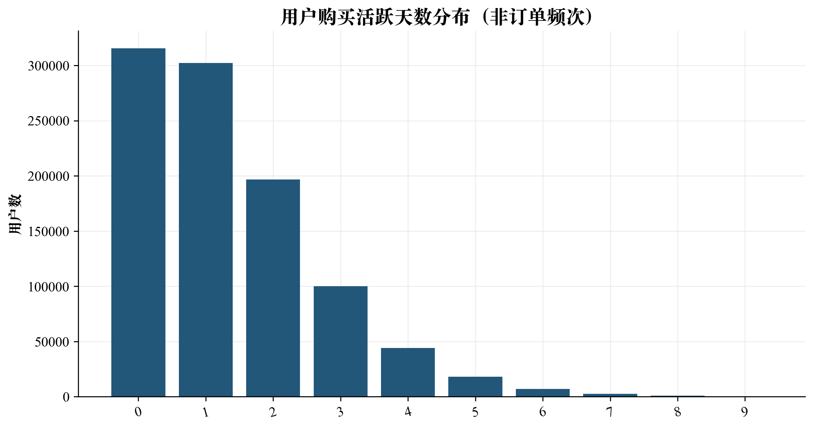

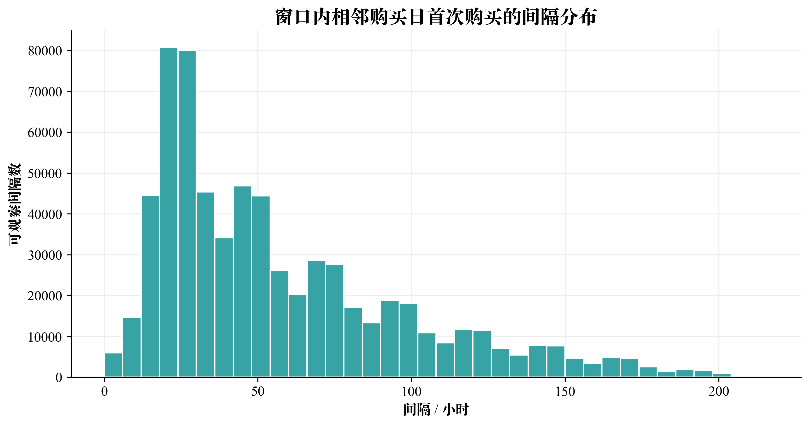

### 相同3天随访的再次购买

| first | users | repeat_users | repeat_rate_3d |
| --- | --- | --- | --- |
| 0 | 132622 | 64683 | 0.4877 |
| 1 | 105380 | 47876 | 0.4543 |
| 2 | 93593 | 41341 | 0.4417 |
| 3 | 73048 | 30914 | 0.4232 |
| 4 | 65194 | 27573 | 0.4229 |
| 5 | 56402 | 23841 | 0.4227 |

首次观察购买日≤11月30日的用户才有完整未来3天随访；同日重复购买不计为跨日再次购买。高频购买用户（≥3个购买自然日）共 173,444 人，占购买用户 25.79%，贡献 50.63% 的购买日志；日志贡献不是订单或收入贡献。

### 活跃×购买四象限

高活跃阈值为活跃天数≥7（全体用户活跃天数中位数），高购买为购买活跃天数≥2；低购买含未购。高频购买辅助口径为购买≥3个自然日；阈值敏感性表比较活跃阈值上下1天及购买阈值2/3天。

| segment | users | pv | buyers | mean_active_days | mean_purchase_days | fav_users | cart_users | mean_categories | share |
| --- | --- | --- | --- | --- | --- | --- | --- | --- | --- |
| 低活跃＋低购买 | 270845 | 11717913 | 116971 | 5.0406 | 0.4319 | 78070 | 167986 | 13.7444 | 0.2741 |
| 低活跃＋高购买 | 79632 | 4041538 | 79632 | 5.2887 | 2.3877 | 24394 | 55130 | 15.8535 | 0.0806 |
| 高活跃＋低购买 | 346872 | 36855305 | 185159 | 8.0138 | 0.5338 | 151187 | 266577 | 27.5819 | 0.3511 |
| 高活跃＋高购买 | 290642 | 37045932 | 290642 | 8.2659 | 2.9012 | 136172 | 249303 | 33.1644 | 0.2942 |

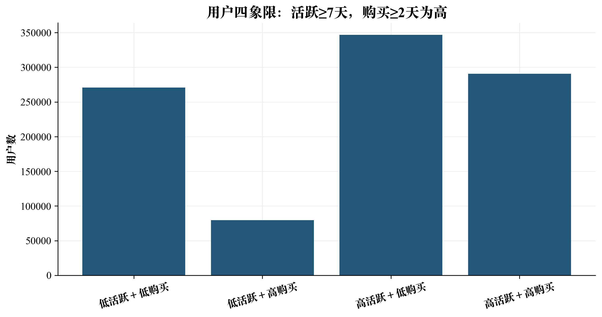

各群浏览次数最高的前三个匿名品类（偏好指数=群内PV占比/整体PV占比）：

| segment | category_id | pv | segment_pv_share | preference_lift |
| --- | --- | --- | --- | --- |
| 低活跃＋低购买 | 4756105 | 612712 | 0.0523 | 1.0470 |
| 低活跃＋低购买 | 4145813 | 384639 | 0.0328 | 0.9341 |
| 低活跃＋低购买 | 2355072 | 344904 | 0.0294 | 0.8373 |
| 低活跃＋高购买 | 4756105 | 172615 | 0.0427 | 0.8552 |
| 低活跃＋高购买 | 4145813 | 123418 | 0.0305 | 0.8690 |
| 低活跃＋高购买 | 982926 | 99491 | 0.0246 | 0.7886 |
| 高活跃＋低购买 | 4756105 | 1989365 | 0.0540 | 1.0808 |
| 高活跃＋低购买 | 2355072 | 1476981 | 0.0401 | 1.1401 |
| 高活跃＋低购买 | 3607361 | 1430654 | 0.0388 | 1.1694 |
| 高活跃＋高购买 | 4756105 | 1702990 | 0.0460 | 0.9205 |
| 高活跃＋高购买 | 4145813 | 1270151 | 0.0343 | 0.9757 |
| 高活跃＋高购买 | 2355072 | 1237561 | 0.0334 | 0.9503 |

高活跃＋低购买群有 346,872 人，占全部活跃用户 35.11%；其中窗口内未购买但加购者 117,340 人，是可进一步核查触达资格与商品状态的人群规模，不是预期增量。

四象限用于全窗口画像，高购买群购买更多是定义本身。高活跃低购买群优先拆分“未购但加购、未购仅收藏、纯浏览”，明细见 `segment_intents.csv`，不能用全窗口购买标签论证其预测能力。高频购买分布见 `high_frequency_profile.csv`。各层浏览品类偏好见 `segment_category_preferences.csv` 与 `segment_top_categories.csv`：以该层各品类PV占比除以整体对应PV占比得到偏好指数，仅解释浏览构成，不等同于购买意愿。

## 五、商品与品类运营

商品排名分别按PV、浏览UV、购买UV、顺序转化率输出。散点图为避免遮挡固定种子42随机展示至多20,000个合格对象，排名、阈值、象限汇总均使用全量数据。转化排名主门槛为至少100个合格浏览起点对；在合格商品中，高流量阈值为浏览UV≥344（P75），高转化为24小时转化率≥0.68%（中位数）。达到门槛的商品 110,545 / 全部商品 4,161,138，低样本商品不进入转化排名，完整排除清单见 `06_items/item_id_insufficient_sample.csv.gz` 与对应品类文件。

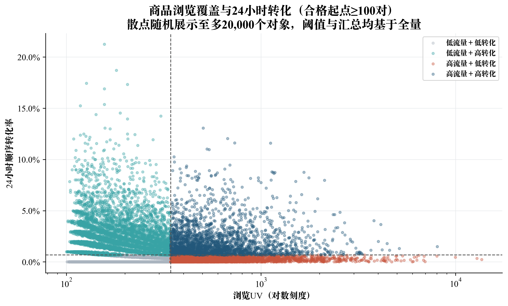

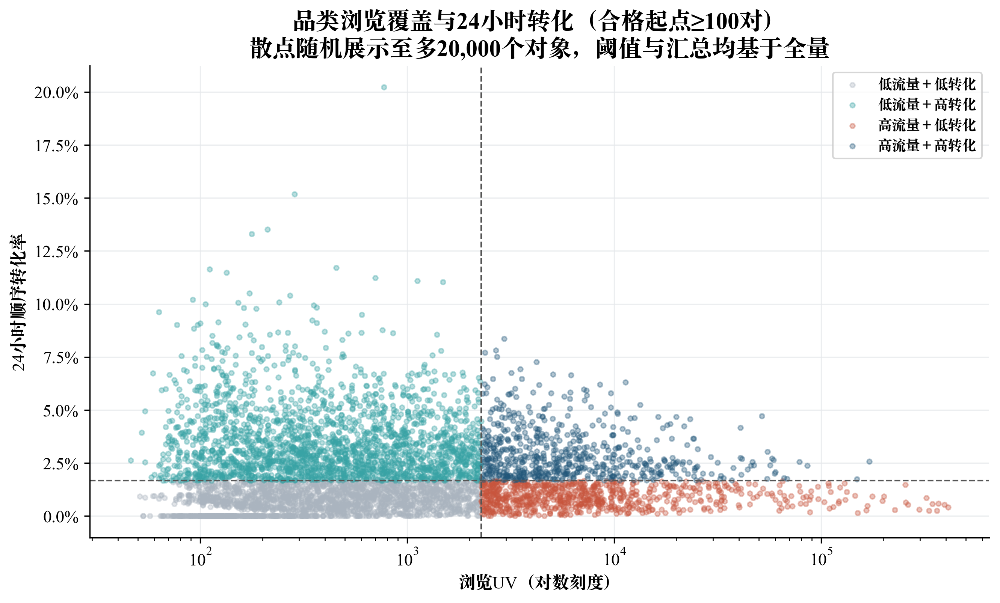

品类象限独立使用其合格样本分布确定阈值；品类内部转化仍以用户—商品对为单位，不是品类去重用户购买率。商品Top10/Top100的PV集中度为 0.23% / 1.20%。

### 高流量低转化商品候选（前10）

| item_id | pv_uv | eligible_pairs | converted_pairs | conversion_rate |
| --- | --- | --- | --- | --- |
| 812879 | 20667 | 18369 | 64 | 0.0035 |
| 3845720 | 17163 | 15034 | 44 | 0.0029 |
| 59883 | 16701 | 13987 | 7 | 0.0005 |
| 1535294 | 16340 | 12622 | 55 | 0.0044 |
| 2331370 | 15319 | 13351 | 61 | 0.0046 |
| 2032668 | 15168 | 13099 | 19 | 0.0015 |
| 138964 | 14330 | 12277 | 43 | 0.0035 |
| 2453685 | 13703 | 11562 | 59 | 0.0051 |
| 2818406 | 13612 | 11714 | 33 | 0.0028 |
| 2279428 | 13595 | 10193 | 24 | 0.0024 |

清单首位商品ID为 812879；浏览UV为 20,667，合格起点对数为 18,369，24小时转化率为 0.35%。这些商品浏览覆盖较高且观察到的后续购买比例较低，建议优先核对流量质量、商品可售状态和详情信息。价格/库存/评价等只是候选原因。低流量高转化候选见 `item_id_low_traffic_high_conversion.csv`，扩流前需核查样本稳定性；50/100/200起点门槛敏感性见相应CSV。

## 六、运营建议与待实施验证

| 优先项 | 观察证据 | 候选解释及补充数据 | 可执行验证 |
| --- | --- | --- | --- |
| 意向未购用户承接 | 加购、收藏起点存在大量24小时未转化对 | 可能需求延迟或商品条件不符；需触达资格、库存、价格等 | 对合格未购用户进行用户级随机提醒实验 |
| 高流量低转化商品排查 | 候选清单同时给出流量和顺序转化分母 | 流量错配、库存或信息不足均待验证 | 补充商品/渠道数据后分层；对明确可改的问题做实验 |
| 运营时段安排 | 浏览高峰、购买发生与起点转化率已分别量化 | 流量人群构成和跨时购买可能不同 | 同等人群随机分配触达时段并完整随访 |
| 低流量高转化商品试验 | 达到起点门槛后仍有较高转化 | 可能人群精准或样本选择，不保证扩流后保持 | 小范围随机扩流，比较新增覆盖和购买结果 |

### A/B实验方案：加购后未购提醒（尚未实施）

- 目标：检验提醒是否增加后续购买，而非把高购买倾向误作增量。
- 人群：线上确认可售、允许触达、同商品加购满24小时仍未购买的用户；此时才具备已知的24小时未购条件，随后随机分流，不用未来信息入组。
- 分组：用户级1:1随机分为不提醒与提醒；同一用户只入组一次，固定分组，避免跨商品污染。
- 主指标：分流后24小时内指定商品购买用户比例；次指标为任意商品购买用户比例与购买延迟。
- 护栏：退订、投诉、触达频次、其他商品购买是否受挤占。当前数据不包含这些护栏，正式实验必须补充。
- 观察期：覆盖完整业务周期并满足样本量，所有用户具有完整24小时随访；提前约定主要指标、检验方法和停止规则，禁止反复窥视显著性后提前停试。
- 样本量：双侧α=0.05、功效80%；给定线上对照购买率p和最小可检测绝对提升δ后，每组近似 n=2×(1.96+0.84)²×p(1−p)/δ²，再结合重复入组与损耗调整。这里的p需来自上述24小时未购人群在随后24小时的基线，不能用全量加购24小时购买率代替。
- 不报告实际实验提升、利润或ROI；本项目仅交付方案。

## 七、数据质量、验证与局限

- 原始 100,150,807 行；字段无效 0 行；字段有效但窗口外 55,576 行；保留 100,095,231 行。三类互斥核对相等。
- SHA-256：`46fdd7d389c1ddc7922eb7d9014af5573a4a3045da28c6c46197636873d8f1a9`；源文件 3,672,347,465 字节。
- 完全重复额外行 49，主口径保留；去重只影响次数指标，不改变去重用户、首次行为、二元转化与购买日频次，次数敏感性见下表。
- 同用户同商品同秒存在多类行为的组合数 4；不推断其先后，转化要求严格时间顺序。
- 对应多个品类的商品 1,405 个；如非零，单独清单已输出，品类转化取用户—商品对首次观察到的品类，品类事件指标按原日志归属。
- 逐批验证用户块不重复出现，保证所有用户历史完整进入一个批次；解析错误直接终止，未静默跳过畸形行。
- 13 项跨表核对通过，另将用户级总量由SQLite独立重算与总览匹配；验证结果见 `validation.csv`。

| behavior | duplicate_excess | main_events | deduplicated_events | relative_change |
| --- | --- | --- | --- | --- |
| pv | 17 | 89660688 | 89660671 | 0.0000 |
| fav | 0 | 2888258 | 2888258 | 0.0000 |
| cart | 0 | 5530446 | 5530446 | 0.0000 |
| buy | 32 | 2015839 | 2015807 | 0.0000 |

窗口左右截断、匿名样本选择、缺少订单与金额及营销信息限制结论外推。所有运营建议均为待验证假设。简单购买倾向预测是可选扩展，本次优先交付五部分商业分析，不额外开展预测模型。
